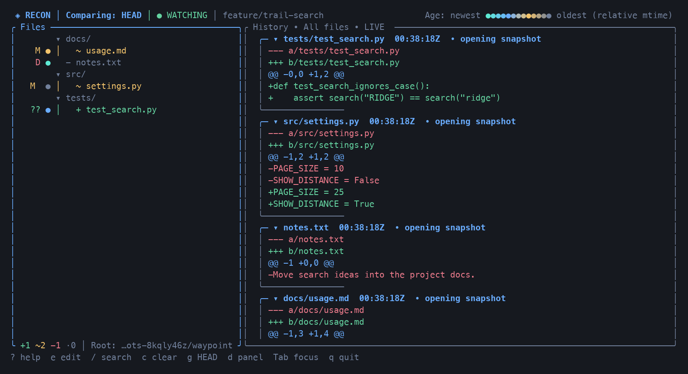
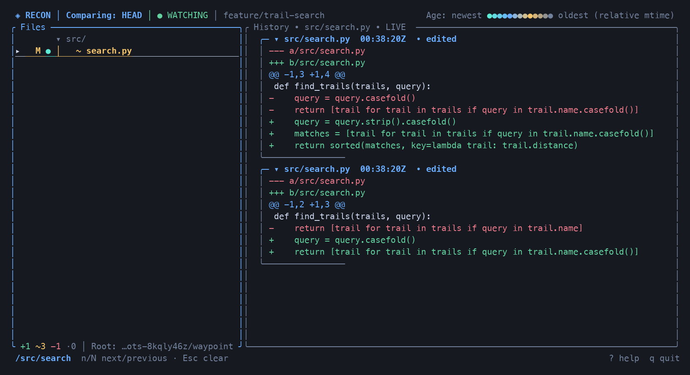
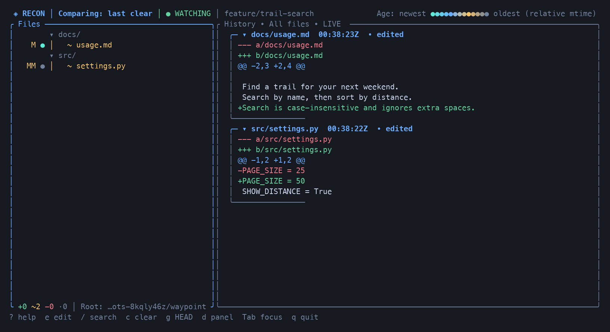

# Recon

https://github.com/user-attachments/assets/4c2f1d95-6850-4693-866a-378c05c6565c

**Watch your Git changes as they happen.** Recon is a terminal app that shows
changed files alongside a live history of the edits it observes. Keep it open
beside your editor to follow your own work, review an agent's edits, or see how a
change evolved across several saves.



Recon reads your repository without staging, resetting, or committing anything.
It works with ordinary Git repositories, linked worktrees, and repositories that
have not made their first commit.

## Install

Download the archive for your machine from
[GitHub Releases](https://github.com/oli-nelson/Recon/releases).

| Your machine | Archive suffix |
| --- | --- |
| macOS, Apple Silicon | `macos-arm64.tar.gz` |
| macOS, Intel | `macos-x64.tar.gz` |
| Linux, x64 | `linux-x64.tar.gz` |
| Windows, x64 | `windows-x64.tar.gz` |

Extract the archive and put `recon` (or `recon.exe` on Windows) in a directory
on your `PATH`. Open a terminal and check:

```sh
recon --version
```

You need Git and a terminal. Linux builds require a glibc-based distribution
compatible with Ubuntu 22.04 or newer. Windows may need the Microsoft Visual C++
x64 runtime. Binaries are unsigned; macOS builds are not notarized. Releases
include `SHA256SUMS` for verifying downloads.

<details>
<summary>Build from source (Rust 1.88 or later)</summary>

```sh
git clone https://github.com/oli-nelson/Recon.git
cd Recon
cargo install --path . --locked
recon --version
```

Cargo installs into its binary directory (usually `~/.cargo/bin`), which must be
on your `PATH`.

</details>

## Start watching

Run Recon from your repository, or give it a path:

```sh
recon
recon /path/to/your/project
```

1. **See what has changed.** Recon opens with a comparison against `HEAD`,
   including staged, unstaged, and nonignored untracked files.
2. **Keep working in your editor.** Each observed save adds a new entry at the
   top of the history pane. Select a file and press `Enter` to focus its history;
   press `Esc` to return to all files.
3. **Focus on the next task.** Press `c` to discard the displayed history and use
   the current file contents as a fresh baseline. This does not change your files
   or Git index. Press `g` to discard history and compare against `HEAD` again.

History lives in memory for the current session. It is bounded and records
observed changes, not every keystroke: rapid saves can coalesce. Use Git commits
for durable history. When `HEAD` changes, Recon starts a fresh snapshot.

## Follow an edit from save to save

Search with `/`, type part of a file path, and press `Enter` to keep the filter.
Search matches full repository-relative paths, ignoring case, and filters both
files and history. Use `n` / `N` to move between matches and `Esc` to clear it.



The history shows transitions, so undoing an edit adds a reverse change. Scroll
back to read earlier entries; new edits preserve your reading position while
following is paused. Press `f` to resume following the newest changes.

After `c`, only subsequent edits are compared with the captured contents. Git
status remains visible independently:



## Read the file tree

| Marker | Meaning |
| --- | --- |
| `+` | New relative to the active baseline |
| `~` | Modified relative to the active baseline |
| `−` | Deleted relative to the active baseline |
| `·` | No net content change relative to the active baseline |
| Git `XY` column | Index status, then working-tree status; `??` means untracked |
| Colored `●` | Relative file modification-time recency; see the header legend |

The header tells you whether the baseline is `HEAD` or **last clear**. A file's
baseline marker can differ from its Git status. Staging updates Git status
without adding a content edit. Binary and oversized files show summaries.

## Essential shortcuts

Press `?` inside Recon for help, including any shortcuts you have customized.

| Key | Action |
| --- | --- |
| `j` / `k` or Up / Down | Move through files or history entries |
| `Enter` | Focus file history; toggle a directory or history entry |
| `Tab` | Switch between files and history |
| `h` / `l` or Left / Right | Collapse/expand directories; scroll history horizontally |
| `/`, `n` / `N` | Search paths; next / previous match |
| `Esc` | Clear the accepted search and show all history |
| `PageUp` / `PageDown`, `Ctrl-U` / `Ctrl-D` | Scroll history |
| `f` | Toggle live following; resume at the newest entry |
| `c` / `g` | Start fresh from current contents / `HEAD` |
| `[` / `]` | Widen / narrow history (or drag the divider) |
| `d` | Hide / show history |
| `e` | Open the focused file in your editor |
| `?` / `q` | Help / quit |

Recon uses `VISUAL`, then `EDITOR`, falling back to `vi` on Unix/macOS or Notepad
on Windows. For a GUI editor, include its wait option, for example
`EDITOR='code --wait'`. Recon suspends while the editor runs and resumes when it
exits. In narrow terminals, use `Tab` to switch panes.

## Make it yours

```sh
recon --theme ashen
recon --theme light --reduced-motion
recon --ignore 'generated/**' --ignore '*.tmp'
recon --once                         # print a snapshot and exit
recon --help                         # all command-line options
```

Recon creates a documented `config.toml` on first use:

- **macOS/Linux:** `$XDG_CONFIG_HOME/recon/config.toml`, or
  `~/.config/recon/config.toml` if the variable is unset, empty, or not absolute.
- **Windows:** `%APPDATA%\recon\config.toml`.
- **Custom location:** `recon --config /path/to/config.toml`.

For example:

```toml
theme = "ashen"                 # dark (default), light, or ashen
reduced_motion = true
ignore = ["generated/**"]

[keybinds]
quit = ["Ctrl-x"]
clear = ["Alt-c"]
```

Restart Recon after editing the config. Command-line options override file
settings. See the [default configuration](config.default.toml) for all options
and the [user guide](docs/GUIDE.md) for keybinding rules and detailed behavior.

By default, Recon retains up to **1,000 history entries or 64 MiB**, whichever
comes first. Text files above **1 MiB** get summaries; retained snapshot text has
a separate **256 MiB** budget. Git ignore rules and your extra ignore patterns
limit which paths are observed.

## More information

- [User guide](docs/GUIDE.md): navigation, history behavior, configuration, and limitations.
- [Changelog](CHANGELOG.md): release notes.
- [Development](docs/DEVELOPMENT.md) and [performance notes](docs/PERFORMANCE.md).
- [Release operations](docs/RELEASES.md) for maintainers.
- [Screenshot capture](docs/SCREENSHOTS.md): reproduce the examples above.

Recon is MIT licensed. Its live terminal viewing approach was informed
by [Livediff](https://github.com/SoCkEt7/Livediff); Recon's baseline and retained
transition history implementation is independent.
